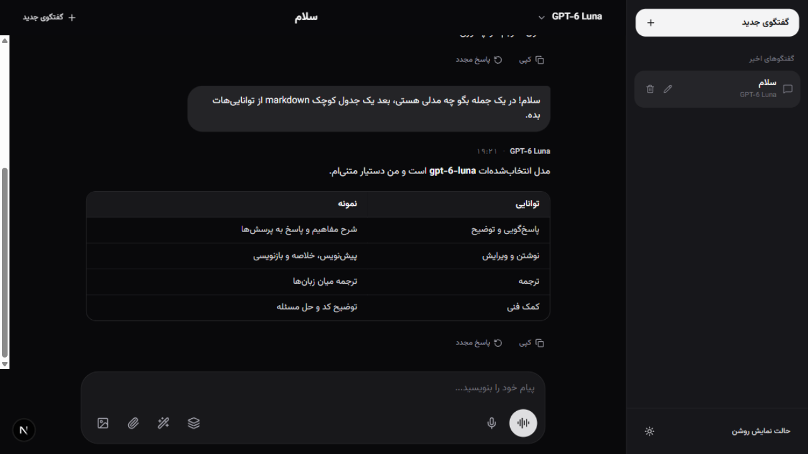

<div align="center">

# 🦆 DuckAI Chat Studio

**A free, ChatGPT-style web client for DuckDuckGo AI Chat (duck.ai) — no API key, no signup.**

*[English](#-english) · [فارسی](#-فارسی)*




</div>

---

<a id="-english"></a>

## 🇬🇧 English

DuckAI Chat Studio turns [duck.ai](https://duck.ai) — DuckDuckGo's free AI chat — into a full chat app: streaming answers, markdown rendering, vision, image generation, file analysis, multi-model council mode, and voice — all behind a clean RTL-friendly UI.

> **100% free.** DuckDuckGo provides the models; this project just provides a nicer front door. The only optional key is a Gemini fallback (see [Environment variables](#environment-variables)).

### ✨ Features

| | |
|---|---|
| 💬 **9 free models** | GPT-6 Luna, GPT-5.6 Luna, GPT-5.4 Mini/Nano, Claude Haiku 5.5/4.5, Gemma 4 31B, GPT-OSS 120B, Mistral Small 4 — switch mid-conversation |
| ⚡ **Streaming** | Token-by-token SSE streaming with full Markdown (tables, code blocks) |
| 👁 **Vision** | Send images (auto-converted to WebP ≤1568px via `sharp`) and ask about them |
| 🎨 **Image generation** | `/draw` with 1K/2K/4K quality tiers and 5 aspect ratios, upscaled & sharpened server-side |
| 📄 **File analysis** | Attach code/text files (40+ extensions) injected into the prompt |
| 🏛 **Council mode** | Three models answer the same prompt, then synthesize or debate each other |
| 🎙 **Voice** | Live voice conversation + speech-to-text dictation |
| ⌨️ **Slash commands** | `/model`, `/draw`, `/council`, `/clear`, `/help`, … |
| 🗂 **History** | Chats persisted in `localStorage`, rename & delete, dark/light theme |

### 🧠 How it works

```
Browser ──NDJSON stream──▶ /api/duckchat (Next.js route)
                              │
                              ├─ 1. Fetch duck.ai → read fe-version
                              ├─ 2. GET /duckchat/v1/status → receive anti-bot challenge (x-vqd-hash-1)
                              ├─ 3. Solve challenge in a sandboxed jsdom environment
                              ├─ 4. POST /duckchat/v1/chat → proxy SSE stream
                              └─ 5. Parse events (message deltas, tool calls, generated images) → re-emit as NDJSON
```

The handshake result is cached in memory and only refreshed when duck.ai rotates the challenge, so repeated messages stay fast.

### 🚀 Getting started

**Prerequisites:** [Node.js](https://nodejs.org) **20+** and npm.

```bash
git clone https://github.com/DarkBytee/DuckAiChat.git
cd DuckAiChat
npm install
npm run dev
```

Open **http://localhost:3000** — that's it. No API keys, no accounts.

> **npm note:** if npm blocks native install scripts (Tailwind oxide, sharp, …), approve them once:
> `npm install-scripts approve @tailwindcss/oxide re2 sharp && npm rebuild`

**Production build:**

```bash
npm run build
npm start
```

**Deploy under a sub-path** (e.g. `https://example.com/chatai`):

```bash
NEXT_PUBLIC_BASE_PATH=/chatai npm run build
```

The build uses `output: 'standalone'`, so the result is a self-contained server — easy to drop into any Node container.

### Environment variables

| Variable | Required | Description |
|---|---|---|
| — | — | Nothing is required to run. |
| `GEMINI_API_KEY` | optional | Google Gemini key. Used only as an automatic fallback (chat + image generation) when duck.ai is unreachable. |
| `NEXT_PUBLIC_BASE_PATH` | optional | Base path when deploying under a sub-path (e.g. `/chatai`). |
| `APP_URL` | optional | Public URL of your deployment, used for self-referential links. |

Copy `.env.example` to `.env.local` if you want to set any of these.

### 📁 Project structure

```
app/
  api/duckchat/         # Chat proxy: handshake + challenge + SSE→NDJSON
  api/duckvoice/        # Live voice & dictation endpoints
  page.tsx              # Main chat UI
components/             # Composer, message list, sidebar, modals…
lib/duck-protocol.ts    # Pure protocol layer: models, request builder, SSE parser
lib/webp-converter.ts   # Client-side image conversion
```

### 🩺 Troubleshooting

| Problem | Fix |
|---|---|
| "سرور در حال حاضر پاسخگو نیست" | duck.ai is unreachable from your server or rotated its challenge — retry; check the server logs. |
| 403 / challenge errors | duck.ai changed its anti-bot scheme. Open an issue — the solver may need an update. |
| duck.ai blocked in your region | Deploy on a server in a supported region (the request is made server-side, not from your browser). |
| Native module errors on install | Approve install scripts (see Getting started) and run `npm rebuild`. |

### 🗺 Roadmap

- [ ] Docker image & one-click deploy buttons (Vercel / Cloudflare)
- [ ] Optional password protection for public deployments
- [ ] Chat export/import (Markdown & JSON)
- [ ] Search across chat history
- [ ] Syntax highlighting for code blocks
- [ ] PDF attachment support
- [ ] Multi-language UI (English / فارسی)
- [ ] PWA (installable on mobile)

### ⚠️ Disclaimer

This is an **unofficial** client and is **not affiliated with or endorsed by DuckDuckGo**. It interacts with the public duck.ai service for personal, educational use. Please use it responsibly — don't spam, don't abuse, and remember that model availability and the service itself belong to DuckDuckGo and can change or disappear at any time.

### 🤝 Contributing

PRs are welcome! For bigger changes, open an issue first to discuss what you'd like to change.

### 📄 License

[MIT](LICENSE) © DuckAI Chat Studio Contributors

---

<a id="-فارسی"></a>

## 🇮🇷 فارسی

**DuckAI Chat Studio** یه کلاینت وب کامل برای چت هوش مصنوعی رایگان DuckDuckGo (duck.ai) با ظاهری شبیه ChatGPT است — بدون نیاز به API Key یا ثبت‌نام. جواب‌ها استریم می‌شن، Markdown کامل رندر می‌شه، عکس می‌فرستی و تحویل می‌گیری، تصویر می‌سازی، فایل کد تحلیل می‌کنی، صوتی چت می‌کنی و هر لحظه مدل رو عوض می‌کنی.

### ✨ قابلیت‌ها

- **۹ مدل رایگان:** GPT-6 Luna، GPT-5.6 Luna، GPT-5.4 Mini/Nano، Claude Haiku 5.5/4.5، Gemma 4 31B، GPT-OSS 120B، Mistral Small 4 — با سوییچ وسط گفتگو
- **استریم زنده** پاسخ‌ها با رندر کامل Markdown (جدول و بلوک کد)
- **بینایی:** ارسال تصویر (تبدیل خودکار به WebP با حداکثر ۱۵۶۸ پیکسل)
- **تولید تصویر** با `/draw` — کیفیت 1K/2K/4K و ۵ نسبت ابعاد + شارپ‌سازی سمت سرور
- **تحلیل فایل:** پیوست فایل‌های کد و متن (بیش از ۴۰ پسوند)
- **حالت شورا:** سه مدل هم‌زمان جواب می‌دن و بعد جمع‌بندی یا مناظره می‌شه
- **چت صوتی زنده** و دیکته گفتاری
- **دستورات اسلش:** `/model`، `/draw`، `/council`، `/clear`، `/help` و…
- **تاریخچه گفتگوها** در `localStorage` + تم روشن/تیره و رابط راست‌به‌چپ

### 🚀 راه‌اندازی

پیش‌نیاز: **Node.js نسخه ۲۰ یا بالاتر**

```bash
git clone https://github.com/DarkBytee/DuckAiChat.git
cd DuckAiChat
npm install
npm run dev
```

بعد باز کن: **http://localhost:3000** — همین! هیچ کلید یا اکانتی لازم نیست.

اگر npm اسکریپت‌های نیتیو رو بلاک کرد:

```bash
npm install-scripts approve @tailwindcss/oxide re2 sharp && npm rebuild
```

**بیلد پروداکشن:** `npm run build` و بعد `npm start`
**انتشار زیر زیرمسیر:** `NEXT_PUBLIC_BASE_PATH=/chatai npm run build`

### متغیرهای محیطی

| متغیر | اجباری؟ | توضیح |
|---|---|---|
| — | — | برای اجرا هیچ‌چیز اجباری نیست |
| `GEMINI_API_KEY` | اختیاری | فقط وقتی duck.ai در دسترس نباشه به‌عنوان جایگزین خودکار استفاده می‌شه (چت و تولید تصویر) |
| `NEXT_PUBLIC_BASE_PATH` | اختیاری | انتشار زیر یک زیرمسیر مثل `/chatai` |
| `APP_URL` | اختیاری | آدرس عمومی دیپلای |

### 🧠 چطور کار می‌کنه؟

مسیر `/api/duckchat` سمت سرور: اول صفحهٔ duck.ai رو می‌گیره، چلنج ضدربات (`x-vqd-hash-1`) رو توی یه محیط jsdom ایزوله حل می‌کنه، بعد استریم SSE سرویس چت رو پروکسی می‌کنه و رویدادهاش (دلتای متن، فراخوانی ابزار، تصویر تولیدشده) رو به‌صورت NDJSON برای مرورگر می‌فرسته. نتیجهٔ هندشیک کش می‌شه و فقط وقتی سرویس چلنج رو عوض کنه دوباره گرفته می‌شه.

### ⚠️ سلب مسئولیت

این پروژه یک کلاینت **غیررسمی** است و هیچ وابستگی‌ای به DuckDuckGo ندارد. فقط برای استفادهٔ شخصی و آموزشی ساخته شده. لطفاً مسئولانه استفاده کن — اسپم نزن، سوءاستفاده نکن، و به یاد داشته باش که دسترسی مدل‌ها و خود سرویس متعلق به DuckDuckGo است و ممکن است هر زمان تغییر کند یا قطع شود.

### 📄 مجوز

[MIT](LICENSE)
